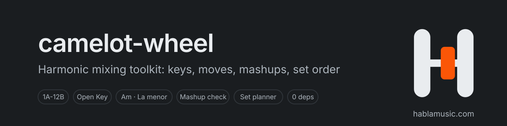

<div align="center">



[](LICENSE)
[](package.json)
[](https://hablamusic.com/es/learn/harmonic-mixing-camelot-wheel?utm_source=github&utm_medium=readme&utm_campaign=camelot-wheel)

**La rueda Camelot en código: convierte cualquier tonalidad a Camelot y Open Key, mira qué tonalidades combinan, revisa un mashup y ordena una playlist como un set armónico.**

</div>

[English](README.md) · Español · [Português (BR)](README.pt-BR.md)

# Rueda Camelot: herramientas de mezcla armónica para DJ

La rueda Camelot le da a cada una de las 24 tonalidades un código de 1A a 12B: el número es la posición en un reloj (cada paso es una quinta) y la letra es el modo (A = menor, B = mayor). Dos temas combinan cuando sus códigos son iguales, están a un número de distancia con la misma letra, o tienen el mismo número con la otra letra. `camelot-wheel` convierte esa regla en una librería JavaScript y una CLI sin dependencias: entiende tonalidades escritas de cualquier forma (`8A`, `1m`, `Am`, `A minor`, `F#m`, `La menor`, `Sol menor`, `Si bemol mayor`), lista los movimientos seguros y de subida de energía, puntúa un mashup de dos temas con el cambio de tono que necesita, y ordena una playlist en un set con transiciones armónicas. La teoría completa está en la [guía de mezcla armónica y rueda Camelot](https://hablamusic.com/es/learn/harmonic-mixing-camelot-wheel?utm_source=github&utm_medium=readme&utm_campaign=camelot-wheel).

## Tabla de la rueda Camelot

| Camelot | Menor | Open Key | Camelot | Mayor | Open Key |
|---|---|---|---|---|---|
| 1A | La♭ menor (Sol♯ menor) | 6m | 1B | Si mayor | 6d |
| 2A | Mi♭ menor (Re♯ menor) | 7m | 2B | Fa♯ mayor | 7d |
| 3A | Si♭ menor | 8m | 3B | Re♭ mayor (Do♯ mayor) | 8d |
| 4A | Fa menor | 9m | 4B | La♭ mayor | 9d |
| 5A | Do menor | 10m | 5B | Mi♭ mayor | 10d |
| 6A | Sol menor | 11m | 6B | Si♭ mayor | 11d |
| 7A | Re menor | 12m | 7B | Fa mayor | 12d |
| 8A | La menor | 1m | 8B | Do mayor | 1d |
| 9A | Mi menor | 2m | 9B | Sol mayor | 2d |
| 10A | Si menor | 3m | 10B | Re mayor | 3d |
| 11A | Fa♯ menor | 4m | 11B | La mayor | 4d |
| 12A | Do♯ menor | 5m | 12B | Mi mayor | 5d |

## Inicio rápido

```bash
npx github:hablamusic/camelot-wheel "La menor"     # 8A, 1m y qué combina
npx github:hablamusic/camelot-wheel mix 96 8A 94 2A
npx github:hablamusic/camelot-wheel wheel --lang es
```

O clónalo y usa `node bin/camelot.js` con los comandos `mix`, `shift`, `set` y `wheel`. Añade `--json` para salida en JSON.

## Movimientos desde una tonalidad

Desde 8A (La menor): 8A igual, 9A y 7A (±1, seguros), 8B (relativa mayor, segura), 10A (+2, subida de energía), 3A (+7 = un semitono arriba, subida clásica), 9B y 7B (diagonales, creativos), 11B (La mayor, cambio de modo dramático).

## Revisar un mashup

`camelot mix 96 8A 94 2A` te dice cuánto estirar el tema B (con mitad/doble tiempo), dónde cae su tonalidad sin key lock y el cambio de tono más pequeño que lo vuelve compatible (aquí −1 semitono → 7A). La puntuación es un filtro rápido, no un veredicto. Para escucharlo, carga ambos temas en el [creador de mashups gratis](https://hablamusic.com/es/dj-tools/mashup-maker?utm_source=github&utm_medium=readme&utm_campaign=camelot-wheel).

## Ordenar un set

`camelot set crate.csv` lee un CSV con `title`/`file`, `bpm` y `key`/`camelot` (la salida de [bpm-key-finder](https://github.com/hablamusic/bpm-key-finder) sirve tal cual) y ordena los temas para que cada transición sea un movimiento armónico con poco cambio de tempo. Marca las transiciones que chocan.

## Preguntas frecuentes

**¿Qué tonalidades Camelot combinan?**
Desde cualquier código: el mismo, ±1 con la misma letra y el mismo número con la otra letra. +2 y +7 sirven para subir la energía en transiciones cortas.

**¿Cuál es la diferencia entre Camelot y Open Key?**
La misma idea con otras etiquetas. Open Key (Traktor) empieza en Do mayor = 1d y La menor = 1m.

**¿Cambiar el pitch cambia el código Camelot?**
Sí: un semitono arriba suma 7 (8A → 3A). Sin key lock, acelerar un tema un 6 % lo sube aproximadamente un semitono. `camelot shift` hace la cuenta.

## Relacionado

- [bpm-key-finder](https://github.com/hablamusic/bpm-key-finder): detector de BPM y tonalidad · [awesome-ai-dj-prompts](https://github.com/hablamusic/awesome-ai-dj-prompts): prompts de IA para DJ
- Guías: [mezcla armónica](https://hablamusic.com/es/learn/harmonic-mixing-camelot-wheel?utm_source=github&utm_medium=readme&utm_campaign=camelot-wheel) · [cómo hacer un mashup](https://hablamusic.com/es/learn/how-to-make-a-mashup?utm_source=github&utm_medium=readme&utm_campaign=camelot-wheel) · [cómo empezar a ser DJ](https://hablamusic.com/es/learn/how-to-start-djing?utm_source=github&utm_medium=readme&utm_campaign=camelot-wheel)

## Licencia

MIT. Hecho por [HablaMusic](https://hablamusic.com/es?utm_source=github&utm_medium=readme&utm_campaign=camelot-wheel). "Camelot" se usa aquí como el nombre habitual de esta notación entre DJ; el proyecto no está afiliado a Mixed In Key.
