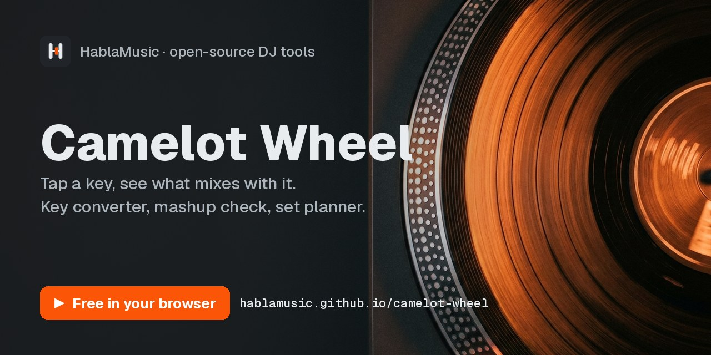

<div align="center">

<a href="https://hablamusic.github.io/camelot-wheel/"></a>

[](LICENSE)
[](#use-it-as-a-library)
[](package.json)
[](#use-it-from-an-ai-agent)
[](https://hablamusic.com/learn/harmonic-mixing-camelot-wheel?utm_source=github&utm_medium=readme&utm_campaign=camelot-wheel)

**The Camelot wheel as code: convert any key to Camelot and Open Key, see which keys mix, check a mashup, and order a playlist into a harmonic DJ set.**

<a href="https://hablamusic.github.io/camelot-wheel/"><b>▶ Open the interactive wheel</b></a> · no install, works on your phone

[Camelot chart](#the-camelot-wheel-chart) · [Quickstart](#quickstart) · [Mixing moves](#mixing-moves) · [Mashup check](#mashup-check) · [Set planner](#set-planner) · [Library](#use-it-as-a-library) · [FAQ](#faq)

</div>

English · [Español](README.es.md) · [Português (BR)](README.pt-BR.md)

# Camelot Wheel: harmonic mixing toolkit for DJs

The Camelot wheel gives each of the 24 musical keys a code from 1A to 12B: the number is the position on a clock face (one step = a perfect fifth) and the letter is the mode (A = minor, B = major). Two tracks mix in key when their codes are the same, one number apart with the same letter, or the same number with the other letter. `camelot-wheel` turns that rule into a zero-dependency JavaScript library and CLI: it reads keys written any way (`8A`, `1m`, `Am`, `A minor`, `F#m`, `La menor`, `Fá# maior`), lists the safe and energy-boost moves from a key, scores a two-track mashup with the pitch shift it needs, and orders a playlist into a set with harmonic transitions. For the theory behind it, read the [Camelot wheel and harmonic mixing guide](https://hablamusic.com/learn/harmonic-mixing-camelot-wheel?utm_source=github&utm_medium=readme&utm_campaign=camelot-wheel).

| **Every notation** | **Mashup math** | **Set planner** |
|:---|:---|:---|
| Camelot, Open Key (Traktor), letter names, sharps and flats, and Spanish/Portuguese solfège (Do, Re, Mi...). | Tempo stretch with half/double time, where the key lands without key lock, and the smallest pitch shift that makes two tracks compatible. | Reads the CSV from [bpm-key-finder](https://github.com/hablamusic/bpm-key-finder) and orders tracks so each transition is a harmonic move with a small tempo change. |

## Start here: pick your way



| You are… | Do this |
|---|---|
| A DJ who just wants the answer | Open the **[interactive wheel](https://hablamusic.github.io/camelot-wheel/)**, tap your key, see what mixes. Type keys in any notation, check a mashup. |
| Fine with copy and paste | With [Node.js LTS](https://nodejs.org/) installed, paste `npx github:hablamusic/camelot-wheel "A minor"` in Terminal or PowerShell |
| Using Claude Code, Cursor or Codex | `npx skills add hablamusic/camelot-wheel`, then ask *"which keys mix with 8A?"* or *"order this playlist into a harmonic set"* |

Green: safe moves (same key, ±1, relative). Orange: energy boosts (+2, +7). Gold: creative moves (diagonals, parallel key).

<br clear="right">

## The Camelot wheel chart

| Camelot | Minor key | Open Key | Camelot | Major key | Open Key |
|---|---|---|---|---|---|
| 1A | A♭ minor (G♯ minor) | 6m | 1B | B major | 6d |
| 2A | E♭ minor (D♯ minor) | 7m | 2B | F♯ major (G♭ major) | 7d |
| 3A | B♭ minor | 8m | 3B | D♭ major (C♯ major) | 8d |
| 4A | F minor | 9m | 4B | A♭ major | 9d |
| 5A | C minor | 10m | 5B | E♭ major | 10d |
| 6A | G minor | 11m | 6B | B♭ major | 11d |
| 7A | D minor | 12m | 7B | F major | 12d |
| 8A | A minor | 1m | 8B | C major | 1d |
| 9A | E minor | 2m | 9B | G major | 2d |
| 10A | B minor | 3m | 10B | D major | 3d |
| 11A | F♯ minor | 4m | 11B | A major | 4d |
| 12A | C♯ minor (D♭ minor) | 5m | 12B | E major | 5d |

Print the chart in Spanish or Portuguese note names with `camelot wheel --lang es` or `--lang pt`.

## Quickstart

```bash
npx github:hablamusic/camelot-wheel Am          # A minor = 8A = 1m, and what mixes with it
npx github:hablamusic/camelot-wheel "La menor"  # same, in Spanish
```

Or clone and run with Node 18+, no install step:

```bash
git clone https://github.com/hablamusic/camelot-wheel && cd camelot-wheel
node bin/camelot.js 8A
node bin/camelot.js mix 128 8A 124 "C major"
node bin/camelot.js shift 8A +2
node bin/camelot.js set examples/crate.csv
node bin/camelot.js wheel --lang es
```

Add `--json` to any command for machine-readable output.

## Mixing moves

```text
$ camelot 8A
A minor  ·  Camelot 8A  ·  Open Key 1m  ·  ES La menor  ·  PT Lá menor
Relative: C major

Mixes with
  8A   A minor    same key           safe     Perfect match: blend for as long as you like.
  9A   E minor    +1                 safe     One step clockwise: a fifth up, lifts the energy slightly.
  7A   D minor    -1                 safe     One step anticlockwise: a fifth down, a calmer move.
  8B   C major    relative major     safe     Same notes, brighter mood.
  10A  B minor    +2                 energy   Two steps up: a whole tone up, a clear energy boost. Keep the overlap short.
  3A   Bb minor   +7 (semitone up)   energy   One semitone up: the classic key-change lift. Works best as a quick cut.
  9B   G major    diagonal           creative Minor to the major one step up: bright and uplifting.
  7B   F major    diagonal back      creative The reverse diagonal: still one note apart, a softer change of colour.
  11B  A major    parallel major     creative Same root note, other mode: dramatic mood switch, short overlap.
```

Why these work: neighbours on the wheel share six of their seven scale notes, the relative major/minor share all seven, and +7 on the wheel is the same as raising the key one semitone (seven fifths = one semitone up, modulo the octave), which is why it sounds like a lift.

## Mashup check

```text
$ camelot mix 96 8A 94 2A
Deck A: 96 BPM, A minor (8A)
Deck B: 94 BPM, Eb minor (2A)

Score: 43/100 (workable with edits)
Tempo: stretch B by +2.1% to 96 BPM
Keys as they are: clash
Without key lock B lands on 2A (+0.4 st): not compatible
Best pitch shift for B: -1 semitones -> 7A (compatible)
```

Tempo matching considers half and double time (a 140 BPM trap beat under a 70 BPM ballad is 1:1 at half time). The score is a simple 50/50 blend of tempo stretch (0 % = best, 16 % or more = worst) and key distance on the wheel; it is a quick filter, not a verdict on whether the mashup sounds good. To hear it, load both tracks into the free in-browser [mashup maker](https://hablamusic.com/dj-tools/mashup-maker?utm_source=github&utm_medium=readme&utm_campaign=camelot-wheel).

## Set planner

Give it a CSV with `title` (or `file`), `bpm` and `key` (or `camelot`) columns. The output of `bpm-key-finder --csv` works as is:

```bash
npx github:hablamusic/bpm-key-finder ~/Music/crate --csv > crate.csv
npx github:hablamusic/camelot-wheel set crate.csv
```

```text
$ camelot set examples/crate.csv          # 19 AI-generated Latin tracks, first lines
 1. 8A   90     reggaeton-4.mp3  ·  start
 2. 8B   96     reggaeton-2.mp3  ·  relative major (safe), tempo +6.7%
 3. 8B   98     reggaeton-3.mp3  ·  same key (safe), tempo +2.1%
 4. 8A   100    cumbia-3.mp3  ·  relative minor (safe), tempo +2%
 5. 3A   94     reggaeton-1.mp3  ·  +7 (semitone up) (energy), tempo -6%
 ...
4 transition(s) clash in key: cut or use an effect there, or pitch-shift one track.
```

It starts from the slowest track (or `--start <title>`), always picks the cheapest next move (key distance first, tempo change second, jumps over 8 % penalised), then improves the order with 2-opt. Transitions that still clash are flagged so you can plan a cut or an effect there.

## Use it as a library

`src/camelot.js` is a single ES module with no imports. It runs in Node 18+, Deno, Bun and browsers.

```js
import { parse, describe, moves, mashup, planSet } from "./src/camelot.js";

describe(parse("F#m"));            // { name: "F# minor", camelot: "11A", openKey: "4m", es: "Fa# menor", ... }
moves(parse("8A")).filter((m) => m.kind === "safe").map((m) => m.code); // ["8A", "9A", "7A", "8B"]
mashup({ bpm: 124, key: "Am" }, { bpm: 122, key: "C" }).score;          // 88
planSet([{ title: "a", bpm: 124, key: "8A" }, { title: "b", bpm: 125, key: "9A" }]);
```

## Use it from an AI agent

`SKILL.md` makes the repo a Claude Code skill (and a Cursor rule / Codex snippet). Ask "what keys mix with F minor?", "can I mash up these two tracks?" or "order this playlist harmonically" and the agent runs the CLI.

```bash
git clone https://github.com/hablamusic/camelot-wheel ~/.claude/skills/camelot-wheel
```

## FAQ

**What is the Camelot wheel?**
A chart that arranges the 24 major and minor keys on a 12-hour clock so DJs can mix in key without music theory. It follows the circle of fifths: each hour is a fifth higher, inner ring (A) minor, outer ring (B) major. The system was created by Mark Davis and popularised by the Mixed In Key software.

**Which Camelot keys are compatible?**
From any code: the same code, ±1 with the same letter, and the same number with the other letter. These four are the "safe" moves. +2 and +7 are energy boosts for short transitions.

**What is the difference between Camelot and Open Key?**
Same idea, different labels. Open Key (used by Traktor) starts at C major = 1d and A minor = 1m, so Open Key = Camelot − 7 (wrapping around 12), with `m` for minor and `d` for major. `camelot 1m` and `camelot 8A` give the same result.

**How do I find the key of a song?**
Use [bpm-key-finder](https://github.com/hablamusic/bpm-key-finder) on your files, or the [online BPM and key finder](https://hablamusic.com/dj-tools/bpm-key-finder?utm_source=github&utm_medium=readme&utm_campaign=camelot-wheel), which runs in the browser without uploading anything.

**Does pitch shifting change the Camelot code?**
Yes. One semitone up moves the code +7 (8A → 3A); one semitone down moves it −7 (8A → 1A). With key lock off, speeding a track up by about 6 % raises it about one semitone. `camelot shift` does the math.

## Related

- [bpm-key-finder](https://github.com/hablamusic/bpm-key-finder): BPM, key and Camelot code for audio files and folders.
- [awesome-ai-dj-prompts](https://github.com/hablamusic/awesome-ai-dj-prompts): AI music prompts for DJ intros, outros and remix beds.
- Guides: [harmonic mixing and the Camelot wheel](https://hablamusic.com/learn/harmonic-mixing-camelot-wheel?utm_source=github&utm_medium=readme&utm_campaign=camelot-wheel) · [how to make a mashup](https://hablamusic.com/learn/how-to-make-a-mashup?utm_source=github&utm_medium=readme&utm_campaign=camelot-wheel) · [how to beatmatch](https://hablamusic.com/learn/how-to-beatmatch?utm_source=github&utm_medium=readme&utm_campaign=camelot-wheel) · [Spanish: mezcla armónica](https://hablamusic.com/es/learn/harmonic-mixing-camelot-wheel?utm_source=github&utm_medium=readme&utm_campaign=camelot-wheel)

## License

MIT. Made by [HablaMusic](https://hablamusic.com/?utm_source=github&utm_medium=readme&utm_campaign=camelot-wheel), an AI music generator with free in-browser DJ tools in English, Spanish and Portuguese. "Camelot" is used here as the common DJ name for this key notation; this project is not affiliated with Mixed In Key.

## Author

Built by **Vlad Yasinski**, AI growth consultant ([roimobi.com](https://www.roimobi.com/?utm_source=github&utm_medium=readme&utm_campaign=camelot-wheel) · [LinkedIn](https://www.linkedin.com/in/vlad-yasinski-ua5er/)), as part of [HablaMusic](https://hablamusic.com/?utm_source=github&utm_medium=readme&utm_campaign=camelot-wheel). More free DJ tools: [github.com/hablamusic](https://github.com/hablamusic) · [hablamusic.github.io](https://hablamusic.github.io/).
