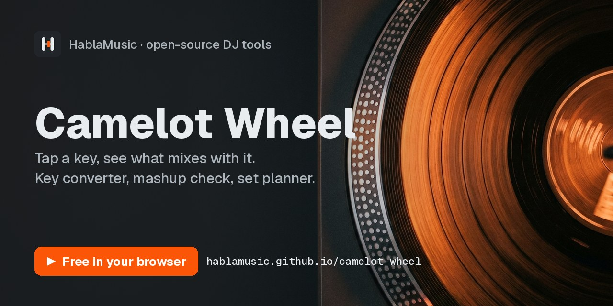

<div align="center">

<a href="https://hablamusic.github.io/camelot-wheel/pt/"></a>

[](LICENSE)
[](package.json)
[](https://hablamusic.com/pt/learn/harmonic-mixing-camelot-wheel?utm_source=github&utm_medium=readme&utm_campaign=camelot-wheel)

**A roda Camelot em código: converta qualquer tom para Camelot e Open Key, veja quais tons combinam, confira um mashup e ordene uma playlist como set harmônico.**

<a href="https://hablamusic.github.io/camelot-wheel/pt/"><b>▶ Abra a roda interativa</b></a> · sem instalar, funciona no celular

</div>

[English](README.md) · [Español](README.es.md) · Português (BR)

# Roda Camelot: ferramentas de mixagem harmônica para DJ

A roda Camelot dá a cada um dos 24 tons um código de 1A a 12B: o número é a posição num relógio (cada passo é uma quinta) e a letra é o modo (A = menor, B = maior). Duas faixas combinam quando os códigos são iguais, estão a um número de distância com a mesma letra, ou têm o mesmo número com a outra letra. O `camelot-wheel` transforma essa regra numa biblioteca JavaScript e numa CLI sem dependências: entende tons escritos de qualquer jeito (`8A`, `1m`, `Am`, `A minor`, `F#m`, `Lá menor`, `Fá# maior`), lista os movimentos seguros e de ganho de energia, avalia um mashup com o ajuste de tom necessário e ordena uma playlist com transições harmônicas. Teoria completa no [guia de mixagem harmônica e roda Camelot](https://hablamusic.com/pt/learn/harmonic-mixing-camelot-wheel?utm_source=github&utm_medium=readme&utm_campaign=camelot-wheel).

## Comece aqui: escolha seu caminho



| Você é… | Faça isto |
|---|---|
| DJ e só quer a resposta | Abra a **[roda interativa](https://hablamusic.github.io/camelot-wheel/pt/)**, toque no seu tom e veja o que combina. Digite tons como quiser (Lá menor, Am, 8A) e confira um mashup. |
| Tranquilo com copiar e colar | Com o [Node.js LTS](https://nodejs.org/pt) instalado, cole `npx github:hablamusic/camelot-wheel "Lá menor"` no Terminal ou PowerShell |
| Usa Claude Code, Cursor ou Codex | `npx skills add hablamusic/camelot-wheel` e pergunte *"quais tons combinam com 8A?"* |

Verde: movimentos seguros. Laranja: ganho de energia (+2, +7). Dourado: movimentos criativos.

<br clear="right">

## Tabela da roda Camelot

| Camelot | Menor | Open Key | Camelot | Maior | Open Key |
|---|---|---|---|---|---|
| 1A | Lá♭ menor (Sol♯ menor) | 6m | 1B | Si maior | 6d |
| 2A | Mi♭ menor (Ré♯ menor) | 7m | 2B | Fá♯ maior | 7d |
| 3A | Si♭ menor | 8m | 3B | Ré♭ maior (Dó♯ maior) | 8d |
| 4A | Fá menor | 9m | 4B | Lá♭ maior | 9d |
| 5A | Dó menor | 10m | 5B | Mi♭ maior | 10d |
| 6A | Sol menor | 11m | 6B | Si♭ maior | 11d |
| 7A | Ré menor | 12m | 7B | Fá maior | 12d |
| 8A | Lá menor | 1m | 8B | Dó maior | 1d |
| 9A | Mi menor | 2m | 9B | Sol maior | 2d |
| 10A | Si menor | 3m | 10B | Ré maior | 3d |
| 11A | Fá♯ menor | 4m | 11B | Lá maior | 4d |
| 12A | Dó♯ menor | 5m | 12B | Mi maior | 5d |

## Começo rápido

```bash
npx github:hablamusic/camelot-wheel "Lá menor"
npx github:hablamusic/camelot-wheel mix 96 8A 94 2A
npx github:hablamusic/camelot-wheel wheel --lang pt
```

Comandos: tom, `mix` (mashup), `shift` (mudança de tom), `set` (ordenar playlist a partir do CSV do [bpm-key-finder](https://github.com/hablamusic/bpm-key-finder)) e `wheel`. Use `--json` para saída em JSON.

## Perguntas frequentes

**Quais tons Camelot combinam?**
A partir de qualquer código: o mesmo, ±1 com a mesma letra e o mesmo número com a outra letra. +2 e +7 aumentam a energia em transições curtas.

**Mudar o pitch muda o código Camelot?**
Sim: um semitom acima soma 7 (8A → 3A). Sem key lock, acelerar 6 % sobe cerca de um semitom.

**Onde ouvir o mashup?**
No [criador de mashups grátis no navegador](https://hablamusic.com/pt/dj-tools/mashup-maker?utm_source=github&utm_medium=readme&utm_campaign=camelot-wheel).

## Relacionado

- [bpm-key-finder](https://github.com/hablamusic/bpm-key-finder) · [awesome-ai-dj-prompts](https://github.com/hablamusic/awesome-ai-dj-prompts)
- Guias: [mixagem harmônica](https://hablamusic.com/pt/learn/harmonic-mixing-camelot-wheel?utm_source=github&utm_medium=readme&utm_campaign=camelot-wheel) · [como fazer um mashup](https://hablamusic.com/pt/learn/how-to-make-a-mashup?utm_source=github&utm_medium=readme&utm_campaign=camelot-wheel)

## Licença

MIT. Feito pela [HablaMusic](https://hablamusic.com/pt?utm_source=github&utm_medium=readme&utm_campaign=camelot-wheel). "Camelot" é usado aqui como o nome comum dessa notação entre DJs; o projeto não é afiliado à Mixed In Key.

## Autor

Criado por **Vlad Yasinski**, consultor de crescimento com IA ([roimobi.com](https://www.roimobi.com/?utm_source=github&utm_medium=readme&utm_campaign=camelot-wheel) · [LinkedIn](https://www.linkedin.com/in/vlad-yasinski-ua5er/)), como parte da [HablaMusic](https://hablamusic.com/pt?utm_source=github&utm_medium=readme&utm_campaign=camelot-wheel). Mais ferramentas de DJ grátis: [github.com/hablamusic](https://github.com/hablamusic) · [hablamusic.github.io](https://hablamusic.github.io/).
